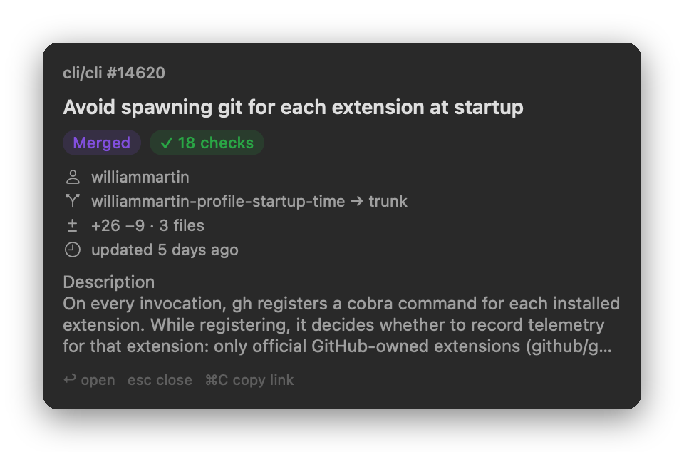

# iterm-peek

Cmd-click a GitHub PR/issue link, a Linear issue link, or a bare Linear ID
(`ENG-123`) in iTerm2 to see a small card next to the cursor: title, state,
review and CI status for PRs, assignee and linked PRs for Linear issues.

- Return, or clicking the title, opens the link. Cmd-clicking the same link again does the same.
- Esc, or a click anywhere else, closes the card.
- Cmd-C copies the link.
- Any other link opens on Cmd-click as usual.
- Right-click a matching link for "Peek" and "Open in browser".

## Install

    make install                       # builds, copies to ~/.local/bin, adds the rules
    make install LINEAR_TEAMS=ENG,OPS  # also peek bare IDs for these Linear teams
    make uninstall

Bare IDs are off unless you list team keys, since a pattern like `ABC-123` also
matches things like `UTF-8` and `SHA-256`. To keep your keys out of the command
line, put `LINEAR_TEAMS = ENG,OPS` in a `config.mk` next to the Makefile
(it's gitignored).

The rules go on every profile except "Web Browser", via the iTerm2 Python API.
GitHub data comes from `gh`. Linear needs `LINEAR_API_KEY`, which is read from
a login shell when iTerm2's own environment doesn't have it.

## How it works

On Cmd-click, iTerm2 runs the first action of the highest-scoring Smart
Selection rule that has actions, before it falls back to opening a URL.
The stock rules have no actions, so these three rules only change Cmd-click for
the links they match.

Links printed as OSC 8 hyperlinks skip Smart Selection on Cmd-click and open
directly. For those, right-click and choose Peek.
